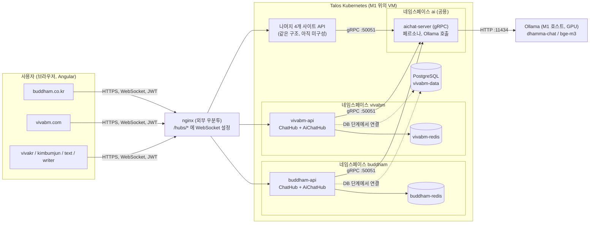
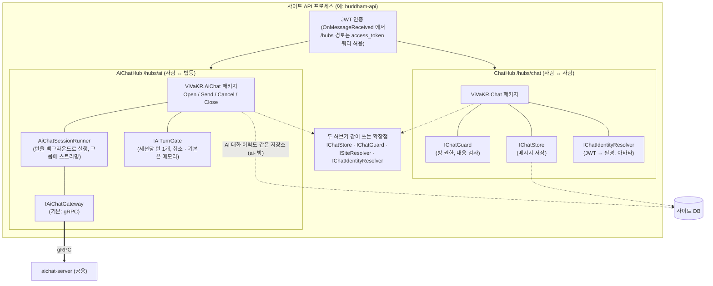
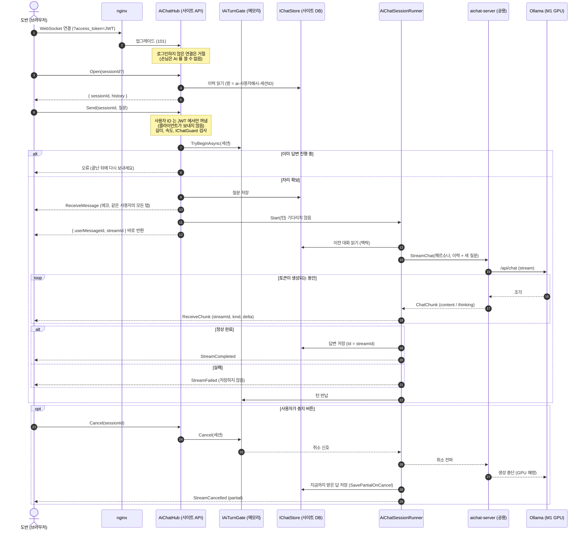
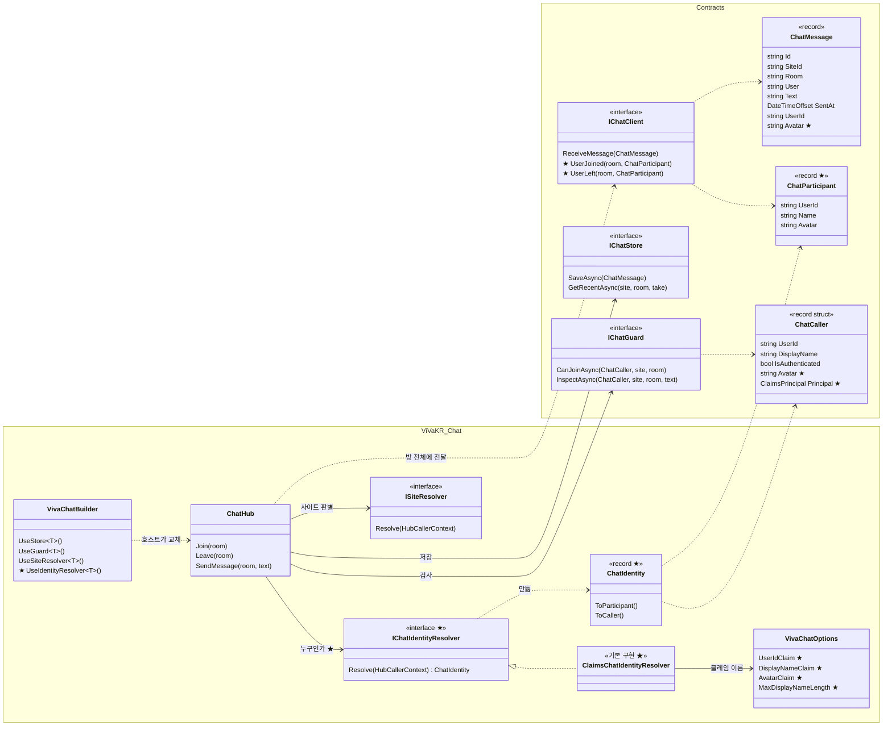
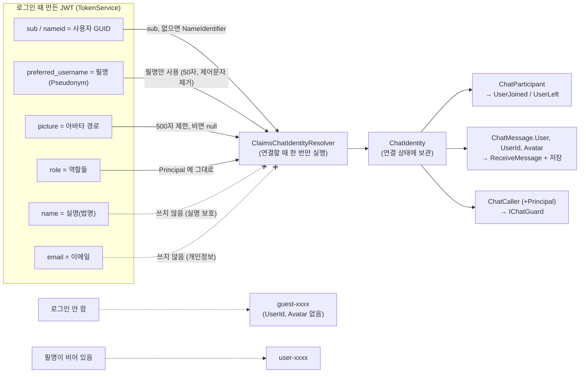
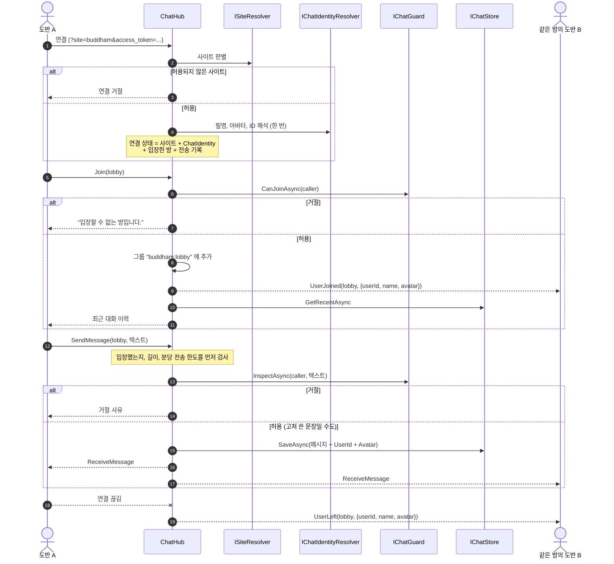
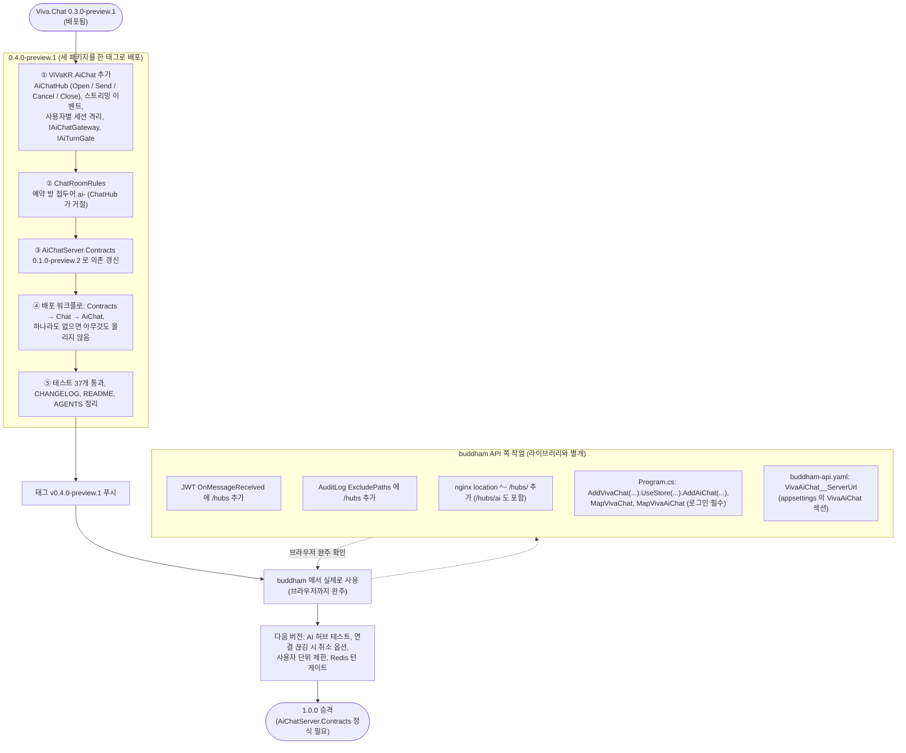

# 관계도 모음 (Mermaid)

지금까지 이야기한 것을 그림으로 정리한 문서야. VS Code라면 Mermaid 미리보기 확장이 있어야 그림으로 보이고, GitHub에 올리면 그대로 그려져.

1. 전체 구조: 사이트 6개와 AI 서버, M1
2. 사이트 API 안의 허브 두 개 (사람 채팅 / AI 채팅)
3. AI 질문 한 번이 지나가는 길 (순서도)
4. Viva.Chat 라이브러리 구조 (클래스)
5. 사용자 식별 흐름 (JWT → 이름, 아바타)
6. 방 입장과 메시지 전송 (0.3 기준 순서도)
7. 이번 수정의 지도 (1~6단계)

---

## 1. 전체 구조

**핵심**: 허브는 사이트마다 따로 있고(인증, 데이터가 사이트별), AI 서버와 GPU는 하나를 모두가 나눠 써.

---

## 2. 사이트 API 안의 허브 두 개

**읽는 법**: 위 칸(ChatHub)은 사람끼리 대화방이고 패키지로 공유해. 아래 칸(AiChatHub)은 법등과의 1:1 대화고, AI 서버를 부르는 것만 다르고 틀은 같아. 두 허브는 섞지 않아.

---

## 3. AI 질문 한 번이 지나가는 길

**읽는 법**: `Send` 는 바로 돌아오고 답변은 이벤트로 흘러와. 중지는 `Cancel` 로만 해. 탭을 닫거나 `Close` 를 불러도 답변은 끝까지 만들어져서 저장돼(GPU 는 최대 300초까지 써). 취소하면 지금까지 받은 답이 저장되고(기본값), 실패한 턴은 저장하지 않아.## 3. AI 질문 한 번이 지나가는 길

---

## 4. Viva.Chat 라이브러리 구조 (0.3)

`★` 표시는 0.3에서 새로 생기거나 바뀐 것이야.

---

## 5. 사용자 식별 흐름 (JWT → 이름, 아바타)

**기억할 것**: 이름과 아바타는 연결 시점의 JWT 스냅샷이야. 필명을 바꾸면 다시 연결한 뒤에 반영돼. 액세스 토큰은 5분이지만, 허브는 연결할 때만 토큰을 검사해서 열린 대화가 끊기지는 않아.

---

## 6. 방 입장과 메시지 전송 (0.3 기준)

---

## 7. 이번 수정의 지도

## 7. 이번 수정의 지도

**지금 해야 할 일 순서**

1. 문서 정리를 마치고 `git add` 로 `src/Viva.Chat.Ai/`, `ChatRoomRules.cs` 가 들어갔는지 확인하기
2. `publish.md` 순서대로 pack → nuspec 확인 → 커밋 → 태그 push
3. buddham API 쪽 5가지는 라이브러리와 따로 진행할 수 있어 (단, `MapVivaAiChat` 은 인증이 설정되어 있어야 시작돼)
